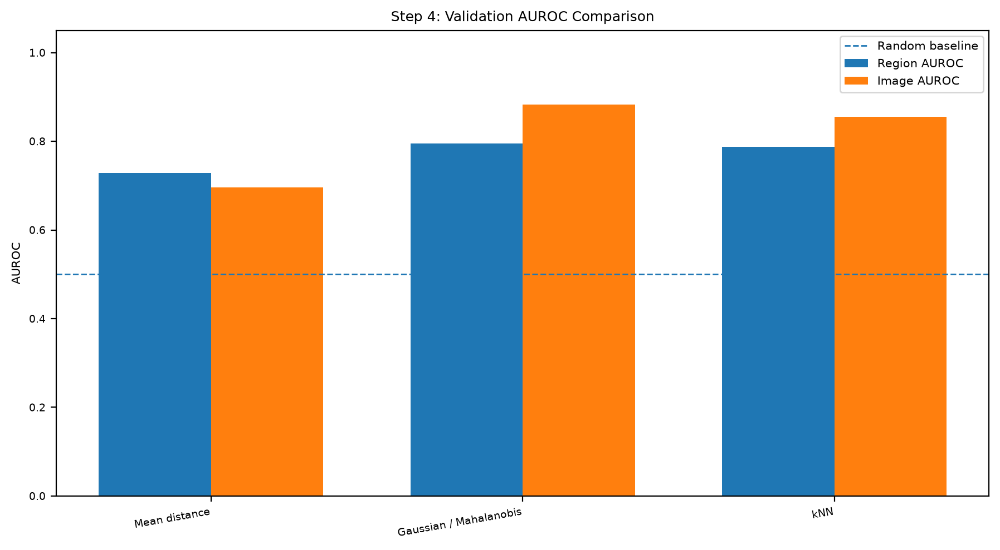
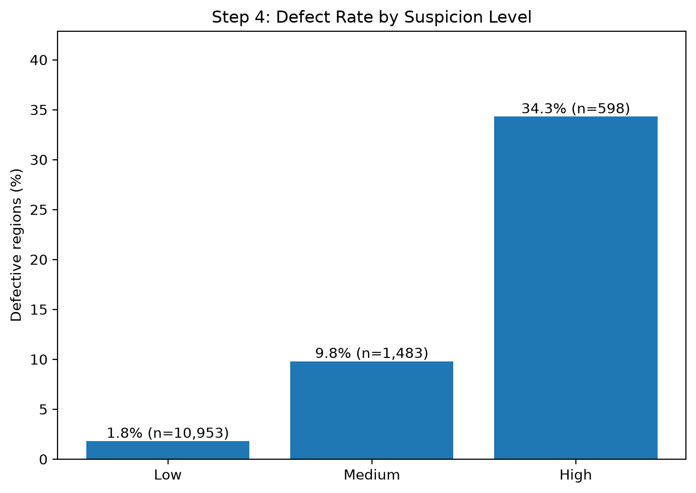
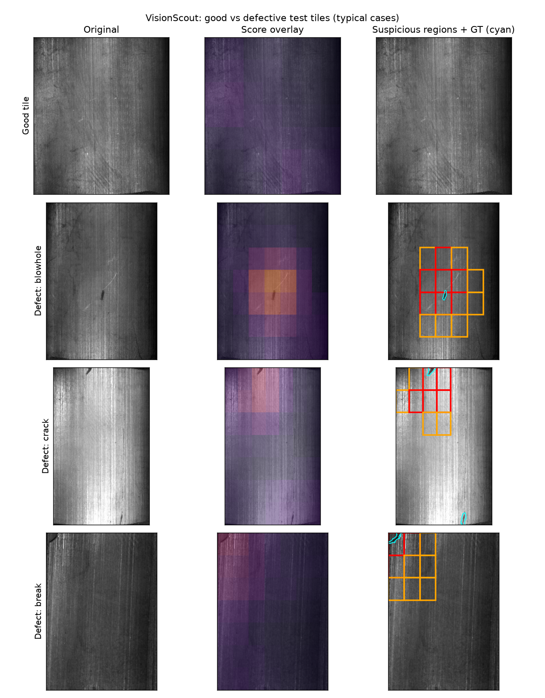
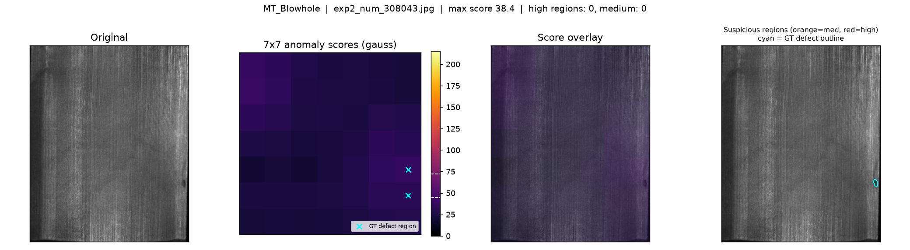
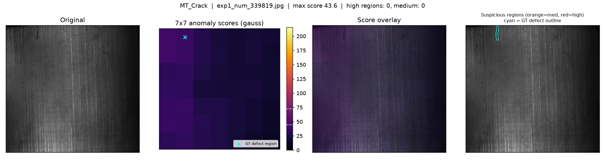
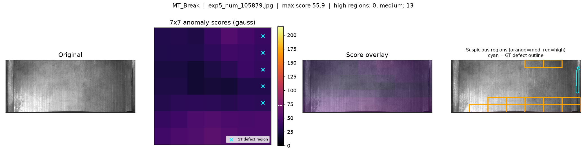
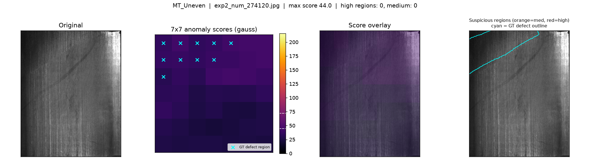
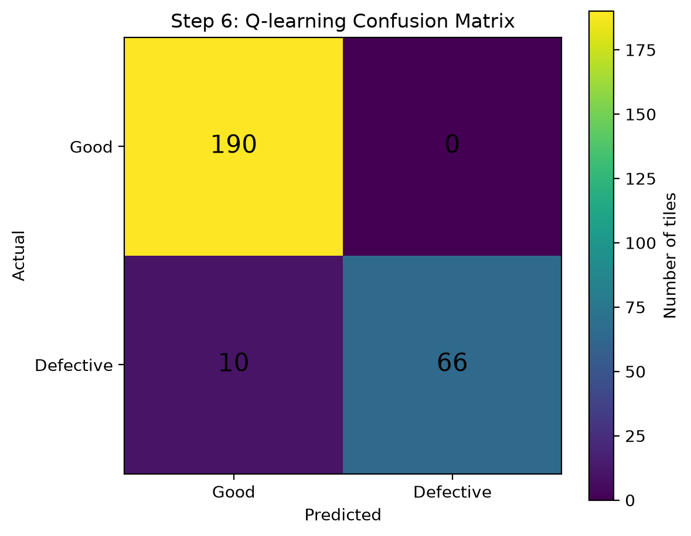
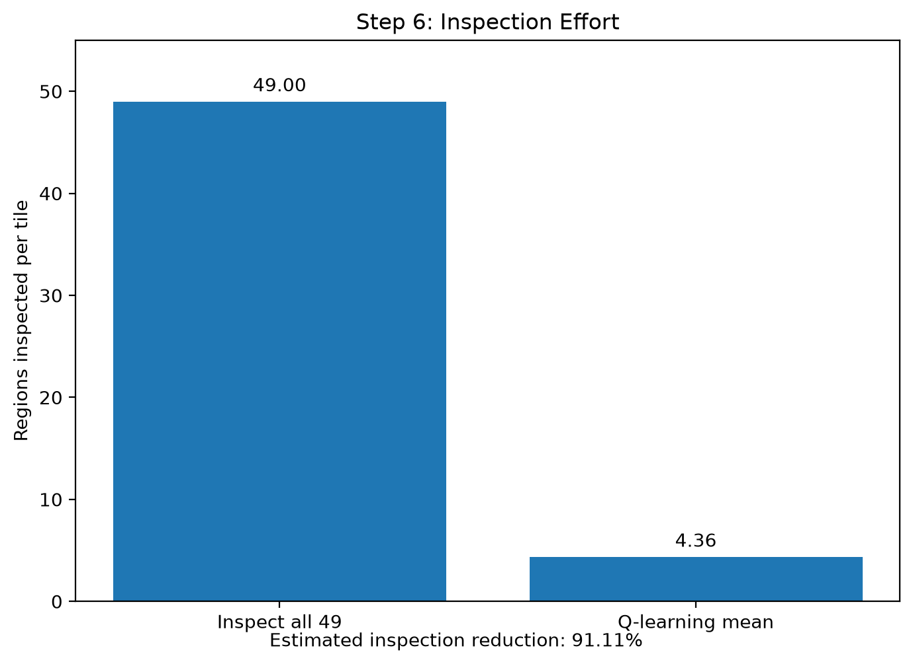
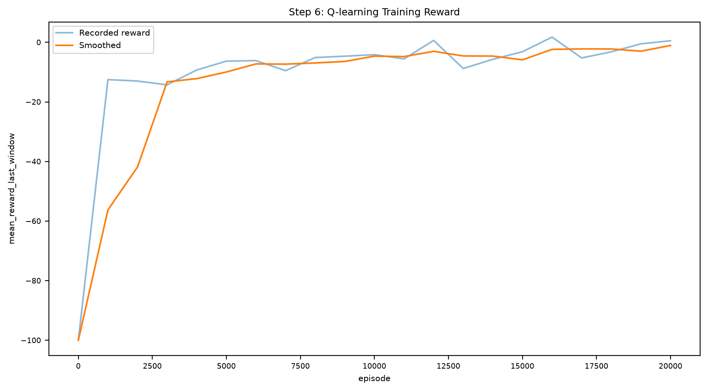

<div align="center">

# VisionScout — RL-Powered Smart Inspection

**Regional defect detection and inspection-policy learning for magnetic tile images**


</div>

VisionScout is a computer-vision inspection system for magnetic tile images. It extracts spatial features with a pretrained ResNet-18, uses Gaussian-based anomaly scoring to rank suspicious regions, and applies a tabular Q-learning agent to choose which regions to inspect and when to accept or reject a tile. The goal is to detect defects while reducing inspection effort.

## Table of Contents

- [Architecture](#architecture)
- [Project Structure](#project-structure)
- [Quickstart](#quickstart)
- [Dataset and Feature Extraction](#dataset-and-feature-extraction)
- [Anomaly Scoring and Visualization](#anomaly-scoring-and-visualization)
- [Experimental Results](#experimental-results)
- [Q-Learning Configuration](#q-learning-configuration)
- [Reproducibility and Limitations](#reproducibility-and-limitations)

## Architecture

```text
Magnetic Tile Images
        |
        v
Dataset and mask preparation
        |
        v
Pretrained ResNet-18 feature extraction
        |
        v
7 x 7 spatial feature map (49 regions)
        |
        v
Gaussian-based regional anomaly scores
        |
        v
Inspection environment
        |
        v
Tabular Q-learning policy
        |
        v
Tile decision + inspection-effort metrics
```

The workflow separates visual feature extraction, anomaly scoring, and sequential inspection. The detector ranks regions by anomaly score; the RL agent uses suspicion levels and inspection costs to decide which region to inspect next or when to stop.

## Project Structure

```text
AI_project2/
├── data/                       # Dataset files
├── figures/                    # Evaluation plots and defect visualizations
├── precompute_features.py      # ResNet-18 feature extraction
├── load_resnet.py              # ResNet model/loading utilities
├── compute_scores.py           # Gaussian-based anomaly scoring
├── step5_environment.py        # Inspection environment
├── RL_q_learning.py            # Q-learning training and evaluation
├── Defect_visual.py             # Defect visualization
├── visualizations.py           # Result visualization utilities
├── generate_results.py         # Generates RESULTS.md from saved artifacts
├── check_features.py           # Feature-artifact checks
├── requirements.txt            # Python dependencies
├── scores.pt                   # Saved anomaly scores
├── step5_data.pt               # Inspection environment data
├── step6_q_table.pt             # Learned Q-table
├── step6_test_metrics.json      # Saved test metrics
├── step6_training_log.csv      # Training log
├── results_summary.json        # Machine-readable result summary
├── RESULTS.md                  # Detailed experiment report
└── README.md
```

## Quickstart

### 1. Clone and install

```bash
git clone https://github.com/jai-time29/AI_project2.git
cd AI_project2

python -m venv .venv
```

Activate the environment:

**Windows PowerShell**
```powershell
.venv\Scripts\Activate.ps1
```

**Linux / macOS**
```bash
source .venv/bin/activate
```

Install dependencies:

```bash
python -m pip install --upgrade pip
pip install -r requirements.txt
```

### 2. Prepare the dataset

Place the Magnetic Tile Defect Dataset where the data-loading and feature-extraction scripts expect it. The dataset itself is obtained separately; the image/mask paths and naming conventions must match the configuration in the scripts.

### 3. Run the pipeline

Run the stages in order:

```bash
python precompute_features.py
python compute_scores.py
python step5_environment.py
python RL_q_learning.py
```

The pipeline generates spatial features, regional anomaly scores, the inspection environment data, and the learned Q-table and evaluation artifacts. To refresh the written experiment report from the saved artifacts, run:

```bash
python generate_results.py
```

## Dataset and Feature Extraction

VisionScout uses the **Magnetic Tile Defect Dataset**. The recorded dataset preparation summary is:

| Dataset item | Count |
|---|---:|
| Images initially collected | 1,344 |
| Good images | 952 |
| Defective images | 392 |
| Images excluded because of empty masks | 4 |
| Images remaining after exclusion | 1,340 |

A pretrained ResNet-18 extracts a `7 × 7 × 512` spatial feature map from each image. This is represented as **49 regions with 512 features per region**. The precomputed regional feature tensor has shape `[N, 49, 512]`, with associated regional labels, image labels, defect types, and image paths.

The recorded evaluation uses 266 test images: 190 good and 76 defective. The training and test partitions should remain separate during detector fitting, threshold selection, and RL training.

## Anomaly Scoring and Visualization

`compute_scores.py` applies Gaussian-based anomaly scoring to regional features. The image is divided into a 7 × 7 grid; each region receives an anomaly score and can be categorized into low, medium, or high suspicion. The RL environment uses these rankings to prioritize inspection.

### AUROC comparison



The validation comparison includes mean-distance, Gaussian/Mahalanobis, and k-nearest-neighbor scoring. From the plotted results, Gaussian/Mahalanobis gives approximately **0.80 region AUROC** and **0.88 image AUROC**; kNN gives approximately **0.79 region AUROC** and **0.85 image AUROC**. The mean-distance baseline is approximately **0.73 region AUROC** and **0.69 image AUROC**. The dashed line indicates random-ranking AUROC (0.50).

### Defect rate by suspicion level



| Suspicion level | Defect rate | Regions |
|---|---:|---:|
| Low | 1.8% | 10,953 |
| Medium | 9.8% | 1,483 |
| High | 34.3% | 598 |

Higher-suspicion regions have a higher observed defect rate, supporting their use as inspection priorities. These percentages are regional defect rates, not image-level precision or recall.

### Defect localization examples

The visualizations compare original images, anomaly heatmaps/score overlays, suspicious grid regions, and ground-truth defect outlines when available.



**Individual defect examples**

| Defect type | Visualization |
|---|---|
| Blowhole |  |
| Crack |  |
| Break |  |
| Uneven surface |  |

Orange boxes indicate medium-suspicion regions, red boxes indicate high-suspicion regions, and cyan outlines show ground-truth defects when available. The grid boxes identify suspicious regions; they are not pixel-accurate segmentation masks.

## Experimental Results

The current saved Q-learning evaluation contains **266 test images** (190 good and 76 defective), with 49 candidate regions per image.

### Image-level classification

| Metric | Result |
|---|---:|
| Accuracy | **96.24%** |
| Defect precision | **100.00%** |
| Defect recall | **86.84%** |
| Specificity / good-tile acceptance | **100.00%** |
| False-reject rate on good tiles | **0.00%** |
| Missed-defect rate | **13.16%** |

### Confusion matrix



| Actual / Predicted | Good | Defective |
|---|---:|---:|
| Good | 190 | 0 |
| Defective | 10 | 66 |

The policy correctly accepted all 190 good tiles and detected 66 of 76 defective tiles. It missed 10 defective tiles. These values correspond to the displayed confusion matrix.

### Inspection efficiency



| Metric | Result |
|---|---:|
| Mean regions inspected per tile | **4.36** |
| Median regions inspected per tile | **1** |
| Regions in exhaustive inspection | 49 |
| Estimated reduction in regions inspected | **91.11%** |

The reduction compares the mean number of regions inspected by the policy with inspecting all 49 regions per tile. It measures inspection count, not elapsed time or total computational cost.

### Training reward



The training plot shows recorded and smoothed mean reward over 20,000 episodes. Reward improves from a strongly negative initial value and trends toward zero/positive values during training; this reflects the configured reward scheme and should be interpreted alongside held-out detection and inspection-effort metrics.

## Q-Learning Configuration

| Parameter | Value |
|---|---|
| Algorithm | Tabular Q-learning |
| Training episodes | 20,000 |
| Learning rate (\(\alpha\)) | 0.10 |
| Discount factor (\(\gamma\)) | 0.95 |
| Initial exploration rate (\(\epsilon\)) | 1.00 |
| Recorded final exploration rate | Approximately 0.067 |
| Maximum inspections per tile | 20 |
| State space | 135 possible states |
| Action space | 5 actions |

The five actions are to inspect a high-, medium-, or low-suspicion region, accept the tile, or reject the tile. The policy trades off inspection cost against the reward/penalty associated with defect discovery and final decisions.

## Reproducibility and Limitations

- `RESULTS.md` contains the detailed report generated from saved artifacts. `results_summary.json`, `step6_test_metrics.json`, and `step6_training_log.csv` preserve machine-readable metrics and training information.
- Rebuild the report after regenerating artifacts with `python generate_results.py`.
- The recorded test metrics describe the current saved run. They do not, by themselves, establish that the test set was untouched during detector fitting, threshold selection, or hyperparameter tuning.
- Ten defective test tiles were missed in the displayed evaluation. Strong performance on this test set does not guarantee identical performance on future data.
- Suspicious-region boxes indicate 7 × 7 grid regions, not pixel-level segmentation.
- The reported inspection reduction is based on the number of regions inspected, not elapsed time or computational cost.
